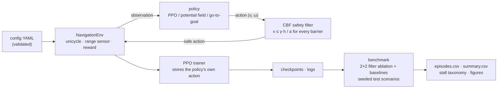

<picture>
  <source media="(prefers-color-scheme: dark)" srcset="docs/assets/banner-dark.svg">
  
</picture>

<p align="center">
  <a href="https://github.com/pouyapd/SafeNav-RL/actions/workflows/tests.yml"></a>
  
  <a href="LICENSE"></a>
  
</p>

<p align="center">
  <a href="#current-status">Status</a> ·
  <a href="#key-results">Key results</a> ·
  <a href="#how-it-works">How it works</a> ·
  <a href="#follow-up-experiments">Follow-up experiments</a> ·
  <a href="#manuscript-and-literature-review">Manuscript</a> ·
  <a href="#quick-start">Quick start</a> ·
  <a href="#limitations-and-open-evidence">Limitations</a>
</p>

**SafeNav-RL studies why learned navigation policies get stuck behind a safety filter.** A control-barrier-function (CBF) safety filter can make a reinforcement-learning (RL) policy collision-free, but it does not make it reach the goal: a robot that may never approach an obstacle can also stall in front of it. This repository contains a reproducible 2D testbed for that problem:
- a simulator with a range sensor;
- PPO agents and two classical controllers;
- a discrete-time CBF speed filter, with a proof of what it guarantees;
- a seeded benchmark;
- an analysis that separates two stall mechanisms.

Everything is simulation. The accompanying manuscript is a **draft that has not been submitted or peer reviewed** ([`paper_draft/manuscript.pdf`](paper_draft/manuscript.pdf)).

## The research problem

Safety filters are a common way to make learned controllers usable in safety-critical settings. For model-based controllers, it is known that CBF filters can create undesired stable equilibria (deadlocks) on the boundary of the safe set. For a *learned* policy the picture is less clear:
- the policy may have been trained with the filter in the loop;
- it sees noisy observations, not the true state;
- its behaviour near obstacles is learned, not designed.

**Question.** By which mechanisms do learned navigation policies deadlock behind a CBF filter, and does the way the policy was trained change the mechanism?

**What this repository contributes.** These claims are restricted to what the saved results support; see [`paper_draft/manuscript.pdf`](paper_draft/manuscript.pdf), Section 1.
- **Elementary properties of the one-step speed filter for a unicycle.** One-step safety does not depend on the turn rate, so heading changes keep the guarantee. Near the keep-out boundary, the headings that allow motion collapse to a half-plane. These follow directly from the model and are not new theory; they explain which remedies can work.
- **A diagnostic procedure for this setting.** It checks every failure against a geometric feasibility oracle and classifies every timeout as *blocked by the filter* or *stopped by the policy*. It reports uncertainty over both training seeds and test scenarios.
- **Evidence that two stall mechanisms exist and depend on training.** The evidence comes from ten PPO agents and two classical controllers, and it was replicated in a pre-registered evaluation on 500 previously unused scenarios.

It does **not** propose a new safety filter or a new training algorithm. The correction penalty tested in E1 is the established method of Pizarro Bejarano et al. (RA-L 2025), used here as a baseline.

## Current status

| Stage | Work | Where |
|---|---|---|
| **Completed** | benchmark: 10 PPO agents (5 seeds, trained with and without the filter) and 2 baselines × 300 seeded test scenarios | [`results/`](results/) |
| **Completed** | stall taxonomy (filter-blocked vs. self-stop), threshold and window sensitivity | [`research/audit_outputs/`](research/audit_outputs/) |
| **Completed, pre-registered** | replication on 500 unused scenarios; test-time heading escape; final vs. selected checkpoints | [`research/experiments/lightweight/`](research/experiments/lightweight/README.md) |
| **Pilot only** | E1 pilot: correction penalty vs. control, 1 seed × 150k steps per arm. **Inconclusive**, supports no claim | [`research/experiments/e1_pilot/`](research/experiments/e1_pilot/README.md) |
| **Pre-registered, not run** | E1a: correction penalty vs. control, 5 seeds × 300k steps per arm | [`research/experiments/E1_correction_penalty.md`](research/experiments/E1_correction_penalty.md) |
| **Untested hypothesis** | cause of self-stops: action aliasing under clipped actions vs. the reward (E4) | manuscript, Discussion |
| **Not done** | corrected scenario generator (E3); published baselines (PPO-Lagrangian, DWA or MPC); any physical robot or 3D simulator | [`paper_draft/minimum_experiments.md`](paper_draft/minimum_experiments.md) |

## Key results

*Simulation: 2D workspace, static circular obstacles, exact kinematics. Nothing here was tested on a robot.*

- **The filter removed every collision.** Across all 3,600 benchmark episodes with the filter on (every controller and stage) there was no collision, and the closest approach was exactly the 0.30 m margin. Without it, the go-to-goal controller collided in 43 % of expert episodes and the PPO agent trained without the filter in 1.0 %.
- **The price is deadlock, by two different mechanisms.** On the expert stage, the PPO agent trained without the filter falls from 94.6 % to 65.0 % success when the filter is added at test time.
  - **Agents trained without the filter are blocked by the filter** at the keep-out boundary (141 of 175 expert timeouts).
  - **Agents trained with the filter mostly stop by themselves** before the boundary (122 of 195).
  - On the expert stage, training with the filter lowered the filter-blocked rate by 14.8 points [5.6, 24.4] and raised the self-stop rate by 17.6 points [8.2, 27.0] (paired hierarchical bootstrap).
- **The mechanisms respond differently to remedies.**
  - Sampling actions instead of taking the policy mean removes most self-stops, but no filter-blocked stalls.
  - A test-time heading escape reduces filter-blocked stalls modestly and leaves self-stops unchanged.
- **The findings replicate on unused scenarios.** In a pre-registered evaluation on 500 new expert scenarios, both training effects were confirmed, and self-stops became *more* frequent with longer training ([details](#follow-up-experiments)).
- **Training with the filter did not clearly help.** With the policy mean, the filter-trained agent reached 61.0 % expert success, against 65.0 % for the agent trained without it and given the filter at test time. With sampled actions the figures were 76.4 % [68.2, 84.6] and 70.0 % [66.3, 73.7]. The intervals overlap.

| Expert stage (100 test scenarios, 8–12 obstacles) | success | collision | timeout |
|---|:---:|:---:|:---:|
| PPO trained without filter · filter off | 94.6 % [91.7, 97.5] | 1.0 % | 4.4 % |
| PPO trained without filter · filter on | 65.0 % [61.5, 68.5] | **0 %** | 35.0 % |
| PPO trained without filter · filter on, sampled actions | 70.0 % [66.3, 73.7] | **0 %** | 30.0 % |
| PPO trained with filter · filter on | 61.0 % [55.4, 66.6] | **0 %** | 39.0 % |
| PPO trained with filter · filter on, sampled actions | 76.4 % [68.2, 84.6] | **0 %** | 23.6 % |
| Potential field · filter on | 72.0 % [62.5, 79.9] | **0 %** | 28.0 % |
| Potential field · filter off | 73.0 % [63.6, 80.7] | 0 % | 27.0 % |
| Go-to-goal · filter on | 46.0 % [36.6, 55.7] | **0 %** | 54.0 % |
| Go-to-goal · filter off | 57.0 % [47.2, 66.3] | 43.0 % | 0 % |

<sub>Each row: controller (for PPO, whether the filter was used during training) · whether the filter is on at test time. PPO rows without "sampled actions" use the policy mean; the two baselines are deterministic. Brackets: 95 % intervals. For PPO, a t-interval over the 5 training seeds (seed variation only); for the baselines, a Wilson interval over the 100 episodes. Sources: <a href="results/benchmark/summary.csv"><code>results/benchmark/summary.csv</code></a>, <a href="results/stochastic_eval/summary.json"><code>results/stochastic_eval/summary.json</code></a>; paired contrasts: <a href="paper_draft/generated/stats.json"><code>paper_draft/generated/stats.json</code></a>.</sub>

<p align="center">
  
</p>
<p align="center"><sub>The first three expert test scenarios (no selection) for four controllers. Dashed circles: the keep-out boundary the filter enforces; dark dots: steps where the filter reduced the speed.</sub></p>

## How it works



| Part | Content |
|---|---|
| **Environment** | Gymnasium env: unicycle robot in a 10 × 10 m workspace with circular obstacles, a simulated 16-beam 360° range sensor, shaped reward, three-stage curriculum, seeded scenarios (`safenav/env/`) |
| **Safety filter** | discrete-time CBF on the speed, with obstacle and wall constraints and a closed-form solution; opt-in correction penalty and test-time heading escape (`safenav/safety/`) |
| **Agents** | PPO actor-critic; go-to-goal and potential-field baselines that read the same observation (`safenav/agents/`) |
| **Training** | PPO with GAE, truncation bootstrapping, linear LR decay, validation-based checkpoint selection, CSV logs, exact resumption, multi-seed runs (`safenav/training/`) |
| **Evaluation** | seeded test episodes; success, collision, timeout, SPL, clearance, filter interventions; Wilson and t intervals; geometric feasibility oracle; benchmark and safety-margin sweep (`safenav/evaluation/`) |
| **Analysis** | stall taxonomy and paired statistics (`research/scripts/`); pre-registered follow-up runners (`research/experiments/`) |

### The safety filter

For every obstacle and wall, a barrier `h` measures the clearance left beyond the margin (`h ≥ 0` means at least 0.30 m from every obstacle surface and 0.10 m from every wall). The filter keeps the policy's turn rate and lowers its speed until `v · a ≤ γ · h` for every barrier the robot is approaching. Here `a` is the closing rate per unit speed and `γ = 0.5 s⁻¹`. All constraints bound the same variable, so this closed form is the exact solution of the safety quadratic program.

| | |
|---|---|
| **Guaranteed** (in the simulator) | `h_{t+1} ≥ (1 − γ·dt) · h_t` at every step, so a robot that starts in the safe set stays in it. Proof in [`docs/SAFETY.md`](docs/SAFETY.md); tested with an adversarial policy. |
| **Assumptions** | exact forward-Euler unicycle dynamics; static circular obstacles known exactly; the true robot state; a safe start; the filter applied at every step. |
| **Between samples** | The guarantee holds at the sampled states. On a straight step of at most 0.1 m the robot can come at most about **1.4 mm** closer than the margin. A unit test checks this bound. Continuous-time motion of a real robot is not covered. |
| **Not guaranteed** | reaching the goal (deadlock is the main failure mode); moving obstacles; sensing errors; a physical robot. |

<p align="center"></p>

### How the filter and the learned policy interact

The next position depends only on the speed, so the filter can slow the robot but never steer it. Near the keep-out boundary, only headings pointing away from the obstacle allow motion. This gives two ways to stall:

| | Filter-blocked stall (Type I) | Self-stop (Type II) |
|---|---|---|
| Typical agent | trained **without** the filter, run with it | trained **with** the filter |
| What happens | the policy keeps commanding full speed (median 1.0 m/s) at the boundary; its heading stays within 90° of the obstacle, so the filter allows no motion | the policy itself commands zero speed, a median 0.41 m before the boundary, mostly with the goal roughly behind the obstacle |
| Responds to | a heading change (modestly) | sampled actions (strongly) |
| Cause | geometry of the one-step filter (manuscript, Proposition 1) | **not established**: action aliasing and the reward are untested candidate explanations |

### Research questions and design

| Question | Design |
|---|---|
| **RQ1.** Which properties of a one-step CBF speed filter determine where and how a filtered robot can stall? | analysis of the filter (manuscript, Section 4) |
| **RQ2.** By which mechanisms do learned policies deadlock behind the filter, and does training with the filter change the mechanism? | 5 seeds per variant × 100 test scenarios per stage; every timeout replayed and classified; paired hierarchical bootstrap over seeds and scenarios; replication on 500 unused scenarios |
| **RQ3.** Which simple remedies remove which mechanism? | sampled actions; test-time heading escape (pre-registered); correction penalty (E1, pilot only) |

## Results in detail

<p align="center"></p>

<p align="center">
  
</p>
<p align="center"><sub>Expert stage: each arrow goes from filter off (hollow) to filter on (filled). The filter moves every controller to zero collisions; how much success it costs depends on the controller.</sub></p>

**Training.** Agents trained without the filter reach about 99 % validation success; agents trained with it level off near 80 % after roughly 0.2M steps. Three of the five filtered seeds selected their best checkpoint (highest validation success) within the first 0.31M steps.

<p align="center"></p>

**Where the policies struggle.** Timeouts grow with the number of obstacles for every controller with the filter on. In every expert test scenario a path that keeps the margin exists (geometric oracle), so none of these timeouts is caused by a blocked path. Replaying every expert timeout of the PPO agents with the filter on (5 training seeds × 100 scenarios per agent type, policy mean):
- **Blocked by the filter (agent trained without the filter): 141 of its 175 timeouts.**
  - The robot sits on the keep-out boundary while the policy commands full speed.
  - The turn rate keeps changing sign (median 70 sign changes in the last 100 steps) without turning the robot away.
  - In all 141 cases the heading is less than 90° from the direction of the nearest obstacle (median 68°).
- **Stopped by the policy itself (agent trained with the filter): 122 of its 195 timeouts.**
  - The policy commands zero speed *before* the boundary (median 0.41 m; interquartile range 0.16–0.72 m).
  - In 89 of the 122, the goal lies within 45° of the direction of the nearest obstacle (median 26°).
  - The robot hardly turns (median |ω| 0.04 rad/s).
  - Another 67 timeouts of this agent are blocked by the filter, and 6 are not stalls.

Sampling actions removes most self-stops (122 → 13 for the agent trained with the filter, 34 → 1 for the agent trained without it), but not the filter-blocked stalls (67 → 71 and 141 → 147).

<sub>A timeout counts as a stall if the robot moves less than 0.10 m in its last 100 steps. It counts as blocked by the filter if the filter reduced the speed in at least half of those steps, and as stopped by the policy if the policy commanded at most 0.001 m/s in at least half of them. This is a post-hoc analysis; varying the thresholds and the window changed the expert counts by at most 4. Scripts: <a href="research/scripts/audit_diagnostics.py"><code>research/scripts/audit_diagnostics.py</code></a>, <a href="research/scripts/stall_taxonomy.py"><code>research/scripts/stall_taxonomy.py</code></a>; per-episode output: <a href="research/audit_outputs/stall_taxonomy_all.csv"><code>research/audit_outputs/stall_taxonomy_all.csv</code></a>.</sub>

<p align="center">
  
  
</p>

**Safety margin.** With an exactly enforced 0.8 m margin (the value in version 0.1), only 54 % of the expert scenarios have any path that keeps the margin, so the default is 0.3 m ([`docs/SAFETY.md`](docs/SAFETY.md)).

<p align="center"></p>

## Follow-up experiments

### Pre-registered evaluation (no training)

These runs reuse the committed agents and train nothing. The hypotheses, the rule for choosing the one free parameter, and the decision criteria were committed **before** the runs ([protocol and full results](research/experiments/lightweight/README.md)).

| Experiment | Result |
|---|---|
| Reproducibility of the evaluation code | all 1,000 committed expert episodes reproduced exactly (outcome and step count) |
| Replication on 500 **unused** expert scenarios (same generator) | filter-blocked: 709 of 792 timeouts (agents trained without the filter); self-stops: 577 of 903 (agents trained with it). Training with the filter: filter-blocked rate −16.5 points [−22.8, −10.1], self-stop rate +19.8 [+12.8, +26.1] |
| **Heading escape** at test time: when the filter cuts the speed, also turn toward the obstacle's tangent (`safenav/safety/heading_escape.py`, opt-in) | agents trained without the filter: success **+7.2 points [+5.0, +9.7]**, filter-blocked rate −7.4 [−10.2, −4.8]. Filter-trained agents: no change in self-stops (+1.5 [−0.8, +3.9]). 0 collisions in 10,000 episodes. The effect is **below** the pre-registered 10-point threshold, and most filter-blocked stalls remain |
| Final 1M-step checkpoints vs. the selected checkpoints (filter-trained agents) | self-stops **+11.7 points [+3.0, +20.8]**, success −4.8 [−8.8, −1.2]: self-stops are not caused by picking early checkpoints. The final checkpoints are local training outputs and are **not** in this repository |

<sub>Brackets: 95 % paired hierarchical bootstrap intervals over 5 training seeds × 500 scenarios (approximate with 5 seeds). Fresh scenarios: expert seeds 9,000,000–9,000,499.</sub>

### E1 pilot: correction penalty (one seed; inconclusive)

The correction penalty of Pizarro Bejarano et al. (RA-L 2025) is implemented as an opt-in term, `safety.correction_penalty`, with a default of 0: during training only, the reward becomes `r − α‖u − u_exec‖²`. The pilot compared α = 1 with an identical control (seed 0, 150k steps per arm) to check the implementation and the cost before the full experiment. The protocol and decision rules were committed before the runs ([pilot README](research/experiments/e1_pilot/README.md)).

| Best checkpoints, 500 fresh expert scenarios (seed base 9,000,000) | Control | Penalty |
|---|---:|---:|
| Success | 58.6 % | 55.4 % |
| Deadlock rate (filter-blocked + self-stop + other stalls) | 39.8 % | 38.6 % |
| Collisions | 0 | 0 |

- **Implementation verified.** With α = 0, a 4,096-step check produced bit-identical weights to the original training code. With α = 1, the penalty demonstrably reached the PPO reward.
- **Effect on actions.** The penalty reduced how much the filter had to correct the policy (the squared correction was about 5× smaller at the end of training) and the intervention rate (45 % → 29 %).
- **Effect on deadlocks.** Penalty − control was −1.2 points [−5.2, 2.8]. This interval reflects scenario variation only, not seed variation.
- **Reading.** By the pre-registered rule, the result is **inconclusive**. With one seed it can neither confirm nor rule out an effect, and it supports no claim in the manuscript.
- **Next step.** The multi-seed experiment (**E1a**, 5 seeds × 300k steps per arm, primary evaluation on 500 unused scenarios with seed base 5,000,000) is pre-registered but **has not been run** ([plan](research/experiments/E1_correction_penalty.md)).

## Manuscript and literature review

| Document | Content |
|---|---|
| [`paper_draft/manuscript.pdf`](paper_draft/manuscript.pdf) · [`manuscript.tex`](paper_draft/manuscript.tex) · [`references.bib`](paper_draft/references.bib) | journal-neutral **draft**, not submitted or peer reviewed; every number is traceable to a repository file ([`figures_and_tables_plan.md`](paper_draft/figures_and_tables_plan.md)) |
| [`paper_draft/evidence_gap_analysis.md`](paper_draft/evidence_gap_analysis.md) · [`minimum_experiments.md`](paper_draft/minimum_experiments.md) | what is supported now, what is missing, and the experiments that would close each gap |
| [`paper_draft/reproducibility_checklist.md`](paper_draft/reproducibility_checklist.md) · [`journal_targeting.md`](paper_draft/journal_targeting.md) | reproducibility status; candidate venues and a realistic readiness assessment |
| [`research/literature_review_gap_analysis.md`](research/literature_review_gap_analysis.md) | targeted (not systematic) literature review: closest work, claim-by-claim novelty assessment, reading depth for each source |
| [`research/LITERATURE_REVIEW.md`](research/LITERATURE_REVIEW.md) · [`research/REPOSITORY_AUDIT.md`](research/REPOSITORY_AUDIT.md) | earlier review and repository audit |

The manuscript marks every claim that the current evidence does not support with **[EVIDENCE REQUIRED]**. There are eight such markers:
- the correction-penalty result (E1, in four places);
- published baselines;
- a corrected scenario generator (E3);
- the cause of self-stops (E4);
- an archived release with a DOI.

## Limitations and open evidence

| Verified | Not verified or not done |
|---|---|
| 99 tests pass; GitHub Actions runs them on Python 3.10 and 3.12 | any physical robot, Gazebo or sim-to-real transfer |
| the committed checkpoints reproduce the published per-episode benchmark results byte for byte | the ROS 2 node in `ros2_integration/` (an untested scaffold; only its scan helpers are tested) |
| the filter's one-step bound under an adversarial policy, and the gap between samples | safety between samples for continuous-time dynamics, moving obstacles or sensing errors |
| the stall taxonomy is insensitive to its thresholds and replicates on 500 unused scenarios (pre-registered) | E1a (correction penalty, multi-seed); E3 (corrected generator); E4 (cause of self-stops); classical and safe-RL baselines |
| the training pipeline end to end at a tiny scale (test); deterministic training and exact resumption | the 1M-step training runs were not repeated on another machine |

- **Simulation only:** 2D, static circular obstacles, exact kinematics, perfect obstacle knowledge for the filter.
- **Scale and tuning:** five training seeds per variant and 100 test scenarios per stage; PPO hyperparameters were not tuned for the filtered setting; the potential field was tuned briefly by hand.
- **Scenario generator:** goal distances are often shorter than the configured stage ranges (see *Environment details*). Three of the 300 test scenarios start inside the goal region, which adds 1–2 points to every success rate in their stages.
- **Test-set reuse:** the safety margin and the sampled-action evaluation were chosen after inspecting the test scenarios. The pre-registered evaluation on 500 unused scenarios reduces this problem but uses the same generator.
- **Literature:** the search behind the novelty claim was targeted, not systematic; some sources were checked only through abstracts or arXiv versions ([details](research/literature_review_gap_analysis.md)).

<details>
<summary><b>Environment details</b></summary>

| | |
|---|---|
| Observation (23 values) | normalised position, sin/cos heading, distance and bearing to the goal, proximity risk, 16 range readings (0–3 m, Gaussian noise) |
| Action | `v ∈ [0, 1] m/s`, `ω ∈ [-1, 1] rad/s` (clipped) |
| Dynamics | forward-Euler unicycle, `dt = 0.1 s` |
| Reward | −0.01 per step + (distance gained) − 0.5 × risk + 10 on reaching the goal − 5 on collision or leaving the workspace |
| Episode end | goal within 0.5 m; collision; leaving the workspace; step limit (200 / 300 / 400 by stage) |
| Curriculum | beginner (2–4 obstacles, goal distance 3–5 m) → intermediate (4–8, 5–8 m) → expert (8–15, 5–12 m); advance at 70 % success over 100 episodes. **These are the requested values, not the generated ones.** Obstacles that do not fit are skipped (8–12 were placed in the 100 expert test scenarios). The start is drawn from [1.5, 5]², and `reset()` clips the goal to [1.5, 8.5]², which shortens many goal distances: 42 of 100 beginner goals are closer than 3 m, and 66 of 100 intermediate and 53 of 100 expert goals are closer than 5 m ([`research/audit_outputs/goal_distances.csv`](research/audit_outputs/goal_distances.csv)) |

</details>

## Quick start

```bash
git clone https://github.com/pouyapd/SafeNav-RL.git
cd SafeNav-RL
pip install -e ".[dev]"              # Python 3.10+; CPU PyTorch is enough
```

The ten trained agents used for the tables are committed in [`results/checkpoints/`](results/checkpoints/): `filtered/` were trained with the filter and `unfiltered/` without it, seeds 0–4.

```bash
# evaluate a committed agent (trained with the filter, seed 0) on the first 20 test scenarios per stage
python -m safenav evaluate --checkpoint results/checkpoints/filtered/seed_0.pt --episodes 20
```

Expected output (filter on by default):

```text
Policy: PPO | safety filter at test time: on
  beginner      success  90.0% [70%, 97%] | collision   0.0% | timeout  10.0% | SPL 0.73 | min clearance (5th pct) 0.56 m
  intermediate  success  65.0% [43%, 82%] | collision   0.0% | timeout  35.0% | SPL 0.51 | min clearance (5th pct) 0.31 m
  expert        success  60.0% [39%, 78%] | collision   0.0% | timeout  40.0% | SPL 0.51 | min clearance (5th pct) 0.30 m
```

```bash
# a baseline, with and without the filter
python -m safenav evaluate --baseline potential_field --episodes 20 --safety-filter off

# plot or animate one seeded episode
python scripts/visualize_trajectory.py --checkpoint results/checkpoints/unfiltered/seed_0.pt --stage expert --seed 2200001 --safety-filter off
python scripts/visualize_trajectory.py --baseline potential_field --animate --save episode.gif

# train one agent (200k steps; roughly 10-15 min on one laptop core, an estimate)
python -m safenav train --run-dir runs/demo --seed 0 --set ppo.total_timesteps=200000
python -m safenav train --run-dir runs/demo --resume          # continue after an interruption

# low-resource, evaluation-only check (one process, below-normal priority, ~1 min, ~210 MB):
# reproduces 1,000 committed expert episodes and classifies every timeout
python research/experiments/lightweight/run_eval.py --tag my_check --agents results/checkpoints \
    --stage expert --seed-base 2200000 --n 100 --kappa 0 --deadline-s 300 --out-root runs/checks
```

<sub>On 2026-10-26 (Windows, Python 3.12, CPU), the evaluate, baseline, plot, animate and low-resource commands ran as shown, and the evaluate output matched the text above exactly. The training command was run with 2,048 steps only; its duration at 200k steps is an estimate. All argument names were re-checked against each command's <code>--help</code> on 2026-11-01.</sub>

## Reproduce the results

**From the committed checkpoints (no training, a few minutes).** These commands regenerate the benchmark and the sampled-action evaluation. Their per-episode outputs are byte-identical to `results/benchmark/episodes.csv` and `results/stochastic_eval/episodes.csv` (verified on 2026-10-25). Each worker process needs about 200 MB of memory; on a machine with little free RAM, use fewer jobs, e.g. `--jobs 2`.

```bash
python -m safenav benchmark --runs results/checkpoints --out runs/check/benchmark --jobs 8
python scripts/stochastic_eval.py --out runs/check/stochastic_eval     # falls back to results/checkpoints/
```

**Everything from scratch.** This means ten 1M-step training runs; on a 10-core laptop CPU they ran in parallel and took 2.6–3.7 hours each.

```bash
python -m safenav train-many --out runs/benchmark --seeds 0 1 2 3 4 --jobs 10
python -m safenav benchmark --runs runs/benchmark --out results/benchmark --jobs 8
python -m safenav safety-sweep --out results/safety_sweep
python scripts/stochastic_eval.py --runs runs/benchmark --out results/stochastic_eval
python -m safenav plot --benchmark results/benchmark --runs results/training_logs --sweep results/safety_sweep
```

**Follow-up experiments.** See the [pre-registered evaluation](research/experiments/lightweight/README.md) and the [E1 pilot](research/experiments/e1_pilot/README.md). Both documents list their exact commands. The pilot trains two agents (150k steps each, a few minutes per arm on an idle machine). Its scripts write to `research/experiments/e1_pilot/results/` by default, so rerun them in a separate clone if you want to keep the committed records unchanged.

| Output | Content |
|---|---|
| `results/benchmark/` | `episodes.csv` (one row per episode), `summary.csv` (rates with intervals per condition and stage), `scenarios.csv` (feasibility oracle per test scenario), `trajectories.npz`, `metadata.json` |
| `results/stochastic_eval/` | deterministic vs. sampled actions for both PPO variants, filter on |
| `results/safety_sweep/` | feasibility and potential-field results for margins 0–0.8 m |
| `results/training_logs/` | progress, validation and summary of each training run |

Training is deterministic for a given seed on CPU, and resumption is exact; tests cover both. Checkpoints were selected by validation success on seeds disjoint from the test seeds.

## Tests

```bash
pytest            # 99 tests, about one to four minutes depending on the machine
```

The tests cover:
- **Simulator:** the unicycle update, termination and reward terms, the range sensor against analytic geometry, and seeding.
- **Safety filter:** its closed-form limits, its invariance under an adversarial policy, and the gap between samples.
- **Opt-in options:** the heading escape and the correction penalty, including an end-to-end check that the penalty reaches the training reward.
- **Training:** GAE against hand-computed values, bit-for-bit reproducibility, and exact resumption.
- **Evaluation:** metrics and intervals, and the feasibility oracle.
- **The rest:** config validation, the baselines, the committed checkpoints, the ROS 2 scan conversion, and an end-to-end train → benchmark → plot run.

## Repository map

```text
SafeNav-RL/
├── safenav/
│   ├── env/          # navigation_env.py, obstacle_map.py (geometry, ray casting), curriculum.py
│   ├── safety/       # cbf_filter.py: CBF filter, SafetyFilterWrapper (opt-in correction penalty);
│   │                 # heading_escape.py: opt-in test-time heading escape
│   ├── agents/       # actor_critic.py, policy.py (PPOPolicy, checkpoints), baselines.py
│   ├── training/     # ppo_trainer.py, rollout_buffer.py, callbacks.py (logs, checkpoints)
│   ├── evaluation/   # metrics.py, runner.py, feasibility.py, benchmark.py, sweep.py
│   ├── viz/          # figures.py, plots.py, style.py
│   ├── config.py     # loading, overrides, validation
│   └── cli.py        # python -m safenav ...
├── configs/default_config.yaml
├── results/          # committed checkpoints, benchmark, safety sweep, sampled-action evaluation, training logs
├── docs/             # SAFETY.md (proof and assumptions), figures/, assets/
├── scripts/          # visualize, train/evaluate wrappers, stochastic_eval.py, v01_safety_layer_check.py
├── research/
│   ├── experiments/  # lightweight/ (pre-registered evaluation), e1_pilot/ (E1 pilot),
│   │                 # E1_correction_penalty.md and e1_evaluate.py (E1a plan, not run)
│   ├── scripts/      # stall taxonomy, statistics, audit diagnostics (read stored outputs only)
│   ├── audit_outputs/
│   └── *.md          # audit, literature reviews, plans
├── paper_draft/      # manuscript draft (LaTeX, PDF, bibliography) and planning documents
├── ros2_integration/ # untested ROS 2 node scaffold + tested scan helpers
└── tests/
```

<details>
<summary><b>Changes in version 0.2</b></summary>

- **Fixed (PPO):** the rollout stored the safety-projected action together with the log-probability of the unprojected sample, so the PPO probability ratio was wrong from the first epoch. The filter now runs inside the environment, and the buffer keeps the policy's own sample.
- **Fixed (GAE):** advantages used `dones[t+1]` for transition `t`, although the buffer stores each transition's own done flag, so bootstrapping leaked across episode boundaries. Time-limit truncations now bootstrap from the value of the final observation.
- **Replaced (safety layer):** version 0.1 only reacted after the robot was inside the margin and had no wall constraint; see [`docs/SAFETY.md`](docs/SAFETY.md) for the measured behaviour and the new filter.
- **Fixed:** `step()` returned NumPy booleans; evaluation episodes were not seeded; the observation size was hard-coded.
- **Added:** range sensor, baselines, evaluation metrics and intervals, feasibility oracle, benchmark, safety-margin sweep, CLI, config validation, exact resumption, committed checkpoints, tests and a CI workflow. The demo images of version 0.1 (`assets/`) came from a checkpoint that is not available and were produced by the old code.

</details>

<details>
<summary><b>Documentation corrections and research additions after version 0.2.0</b></summary>

An audit of version 0.2.0 ([`research/REPOSITORY_AUDIT.md`](research/REPOSITORY_AUDIT.md)) found two statements that the stored data contradict. Both are corrected above, and no code, checkpoint or result file was changed:
- **Failure mechanism.** Steering into the boundary describes the agent trained *without* the filter; the filter-trained agent mostly stops by itself before the boundary.
- **Goal distances.** The curriculum table gave the requested goal-distance ranges as if they were the generated ones.

**Research tools.** None of these changes the default behaviour or any stored result:
- an opt-in heading escape (`safenav/safety/heading_escape.py`);
- an opt-in correction penalty (`safety.correction_penalty`, default 0) and per-update logging of the penalty and of the filter's correction;
- low-resource runners for evaluation and chunked training;
- the pre-registered follow-up evaluation, the E1 pilot, and the manuscript draft.

</details>

## Related projects

- [SafeTraj-Experiments](https://github.com/pouyapd/SafeTraj-Experiments): MSc thesis, failure analysis of pretrained neural trajectory predictors for a smart wheelchair (EU project REXASI-PRO).
- [SafeTraj-Prototype](https://github.com/pouyapd/SafeTraj-Prototype): toolkit for trajectory checks, novelty scores, risk maps and failure rules.
- [trajectory-failure-analysis](https://github.com/pouyapd/trajectory-failure-analysis): interpretable failure analysis of pedestrian trajectory prediction (ETH dataset), preprint.

## Citation

If you use the software, please cite the repository. The manuscript is an unpublished draft, and there is no archived release with a DOI yet.

```bibtex
@software{safenav_rl,
  author  = {Bathaei Pourmand, Pouya},
  title   = {SafeNav-RL: Reinforcement Learning with a Control-Barrier-Function Safety Filter for 2D Robot Navigation},
  year    = {2026},
  version = {0.2.0},
  url     = {https://github.com/pouyapd/SafeNav-RL}
}
```

## License

MIT, see [LICENSE](LICENSE).
