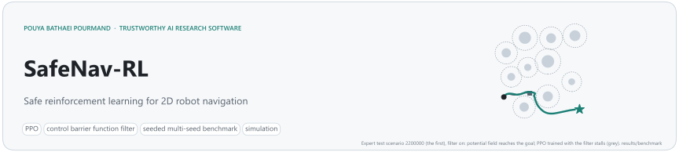

<picture>
  <source media="(prefers-color-scheme: dark)" srcset="docs/assets/banner-dark.svg">
  
</picture>

<p align="center">
  <a href="https://github.com/pouyapd/SafeNav-RL/actions/workflows/tests.yml"></a>
  
  
  <a href="LICENSE"></a>
  
</p>

<p align="center">
  <a href="#key-results">Key results</a> ·
  <a href="#how-the-safety-filter-works">Safety filter</a> ·
  <a href="#quick-start">Quick start</a> ·
  <a href="#reproduce-the-benchmark">Reproduce</a> ·
  <a href="#what-is-verified-and-what-is-not">Verified / not verified</a> ·
  <a href="docs/SAFETY.md">Proof and assumptions</a>
</p>

A learned navigation policy can be made collision-free by a **safety filter** that overrides unsafe commands. The filter's price is less visible: a robot that is never allowed to approach an obstacle can also get stuck in front of it. SafeNav-RL measures both sides. It contains a 2D simulator with a range sensor, PPO agents, a discrete-time control-barrier-function (CBF) speed filter with a proof of what it guarantees, two classical baselines, and a seeded benchmark over five training seeds and 100 fixed test scenarios per difficulty stage.

## Key results

*Simulation: 2D workspace, static circular obstacles, exact kinematics. Nothing here was tested on a robot.*

- **The filter removed every collision.** Across all 3,600 benchmark episodes with the filter on (every controller and stage) there was no collision, and the closest approach was exactly the 0.30 m margin. Without it, the go-to-goal controller collided in 43 % of expert episodes and the PPO agent trained without the filter in 1.0 %.
- **The price is deadlock.** With the filter, robots can stop at a keep-out boundary and time out. On the expert stage the PPO agent trained without the filter falls from 94.6 % success to 65.0 % when the filter is added at test time.
- **Training with the filter in the loop did not clearly help.** With the policy mean (the standard deterministic evaluation) the agent trained with the filter reached 61.0 % expert success, against 65.0 % for the agent trained without it and given the filter at test time. Sampling actions from the policy instead of taking its mean breaks many deadlocks for both agents: **76.4 % [68.2, 84.6]** when trained with the filter, **70.0 % [66.3, 73.7]** when trained without it. These two are the like-for-like comparison (same scenarios, filter on, sampled actions). The intervals overlap, so they do not show that either training setup is better. The potential-field controller with the filter (72.0 % [62.5, 79.9]) is comparable: it is deterministic, its interval is computed differently, and the intervals overlap.

| Expert stage (100 test scenarios, 8–12 obstacles) | success | collision | timeout |
|---|:---:|:---:|:---:|
| PPO trained without filter · filter off | 94.6 % [91.7, 97.5] | 1.0 % | 4.4 % |
| PPO trained without filter · filter on | 65.0 % [61.5, 68.5] | **0 %** | 35.0 % |
| PPO trained without filter · filter on, sampled actions | 70.0 % [66.3, 73.7] | **0 %** | 30.0 % |
| PPO trained with filter · filter on | 61.0 % [55.4, 66.6] | **0 %** | 39.0 % |
| PPO trained with filter · filter on, sampled actions | 76.4 % [68.2, 84.6] | **0 %** | 23.6 % |
| Potential field · filter on | 72.0 % [62.5, 79.9] | **0 %** | 28.0 % |
| Potential field · filter off | 73.0 % [63.6, 80.7] | 0 % | 27.0 % |
| Go-to-goal · filter on | 46.0 % [36.6, 55.7] | **0 %** | 54.0 % |
| Go-to-goal · filter off | 57.0 % [47.2, 66.3] | 43.0 % | 0 % |

<sub>Each row: controller (for PPO, whether the filter was used during training) · whether the filter is on at test time. PPO rows without "sampled actions" use the policy mean; the two baselines are deterministic controllers. Brackets: 95 % intervals; for PPO a t-interval over the 5 training seeds (it reflects variation between seeds only), for the baselines a Wilson interval over the 100 episodes. Sources: <a href="results/benchmark/summary.csv"><code>results/benchmark/summary.csv</code></a>, <a href="results/stochastic_eval/summary.json"><code>results/stochastic_eval/summary.json</code></a>.</sub>

<p align="center">
  
</p>
<p align="center"><sub>The first three expert test scenarios (no selection) for four controllers. Dashed circles: the keep-out boundary the filter enforces; dark dots: steps where the filter reduced the speed.</sub></p>

## How the safety filter works

For every obstacle and wall, a barrier `h` measures the clearance left beyond the margin (`h ≥ 0`: at least 0.30 m from every obstacle surface and 0.10 m from every wall). The filter keeps the policy's turn rate and lowers its speed until, for every barrier the robot is approaching, `v · a ≤ γ · h` (`a`: closing rate per unit speed, `γ = 0.5 s⁻¹`). All constraints bound the same variable, so this closed form is the exact solution of the safety quadratic program.

| | |
|---|---|
| **Guaranteed** (in the simulator) | `h_{t+1} ≥ (1 − γ·dt) · h_t` at every step, so a robot that starts in the safe set stays in it. Proof in [`docs/SAFETY.md`](docs/SAFETY.md); tested with an adversarial policy. |
| **Assumptions** | exact forward-Euler unicycle dynamics; static circular obstacles known exactly; the true robot state; a safe start; the filter applied at every step. |
| **Between samples** | The guarantee holds at the sampled states. On a straight step of at most 0.1 m the robot can come at most about **1.4 mm** closer than the margin (chord of a circle of radius ≥ 0.9 m; walls have no gap). A unit test checks this bound. Continuous-time motion of a real robot is not covered. |
| **Not guaranteed** | reaching the goal (deadlock is the main failure mode); moving obstacles; sensing errors; a physical robot. |
| **Version 0.1 for comparison** | [`scripts/v01_safety_layer_check.py`](scripts/v01_safety_layer_check.py) runs the old safety layer through the same adversarial test: it entered the margin by up to 0.095 m and left the workspace in 2 of 40 episodes; the CBF filter had no violation. |

<p align="center"></p>


| Part | Content |
|---|---|
| **Environment** | Gymnasium env: unicycle robot in a 10 × 10 m workspace with circular obstacles, a simulated 16-beam 360° range sensor, shaped reward, three-stage curriculum, seeded scenarios (`safenav/env/`) |
| **Safety filter** | discrete-time CBF on the speed, obstacle and wall constraints, closed-form solution (`safenav/safety/`) |
| **Agents** | PPO actor-critic; go-to-goal and potential-field baselines that read the same observation (`safenav/agents/`) |
| **Training** | PPO with GAE, truncation bootstrapping, linear LR decay, validation-based checkpoint selection, CSV logs, exact resumption, parallel multi-seed runs (`safenav/training/`) |
| **Evaluation** | seeded test episodes; success, collision (obstacle vs. leaving the workspace), timeout, SPL, path efficiency, clearance, filter interventions, smoothness; Wilson and t intervals; geometric feasibility oracle; benchmark and safety-margin sweep (`safenav/evaluation/`) |
| **Figures** | every README figure is generated from the stored outputs by `python -m safenav plot` (`safenav/viz/`) |

## Results in detail

<p align="center"></p>

<p align="center">
  
</p>
<p align="center"><sub>Expert stage: each arrow goes from filter off (hollow) to filter on (filled). The filter moves every controller to zero collisions; how much success it costs depends on the controller.</sub></p>

**Training.** Agents trained without the filter reach about 99 % validation success; agents trained with it level off near 80 % after roughly 0.2M steps. Three of the five filtered seeds selected their best checkpoint (highest validation success) within the first 0.31M steps.

<p align="center"></p>

**Where the policies struggle.** Timeouts grow with the number of obstacles for every controller with the filter on. Replaying the failed expert episodes of the filter-trained agent shows the mechanism: in most of them the robot reaches a keep-out boundary early and stops there for the rest of the episode, although a path that keeps the margin exists (geometric oracle). The deterministic policy keeps steering into the boundary; sampled actions often escape (table above).

<p align="center">
  
  
</p>

**Safety margin.** With an exactly enforced 0.8 m margin (the value in version 0.1) only 54 % of the expert scenarios have any path that keeps the margin, so the default is 0.3 m ([`docs/SAFETY.md`](docs/SAFETY.md)).

<p align="center"></p>

<details>
<summary><b>Environment details</b></summary>

| | |
|---|---|
| Observation (23 values) | normalised position, sin/cos heading, distance and bearing to the goal, proximity risk, 16 range readings (0–3 m, Gaussian noise) |
| Action | `v ∈ [0, 1] m/s`, `ω ∈ [-1, 1] rad/s` (clipped) |
| Dynamics | forward-Euler unicycle, `dt = 0.1 s` |
| Reward | −0.01 per step + (distance gained) − 0.5 × risk + 10 on reaching the goal − 5 on collision or leaving the workspace |
| Episode end | goal within 0.5 m; collision; leaving the workspace; step limit (200 / 300 / 400 by stage) |
| Curriculum | beginner (2–4 obstacles, goal 3–5 m) → intermediate (4–8, 5–8 m) → expert (8–15 requested, 5–12 m; obstacles that do not fit are skipped, so 7–14 were placed in 3,000 generated scenarios and 8–12 in the 100 test scenarios); advance at 70 % success over 100 episodes |

</details>

## Quick start

```bash
git clone https://github.com/pouyapd/SafeNav-RL.git
cd SafeNav-RL
pip install -e ".[dev]"              # Python 3.10+; CPU PyTorch is enough
```

The ten trained agents used for the tables are committed in [`results/checkpoints/`](results/checkpoints/) (`filtered/` = trained with the filter, `unfiltered/` = without; seeds 0–4).

```bash
# evaluate a committed agent (trained with the filter, seed 0) on the first 20 test scenarios per stage
python -m safenav evaluate --checkpoint results/checkpoints/filtered/seed_0.pt --episodes 20
```

Expected output (filter on by default):

```text
Policy: PPO | safety filter at test time: on
  beginner      success  90.0% [70%, 97%] | collision   0.0% | timeout  10.0% | SPL 0.73 | min clearance (5th pct) 0.56 m
  intermediate  success  65.0% [43%, 82%] | collision   0.0% | timeout  35.0% | SPL 0.51 | min clearance (5th pct) 0.31 m
  expert        success  60.0% [39%, 78%] | collision   0.0% | timeout  40.0% | SPL 0.51 | min clearance (5th pct) 0.30 m
```

```bash
# a baseline, with and without the filter
python -m safenav evaluate --baseline potential_field --episodes 20 --safety-filter off

# plot or animate one seeded episode
python scripts/visualize_trajectory.py --checkpoint results/checkpoints/unfiltered/seed_0.pt --stage expert --seed 2200001 --safety-filter off
python scripts/visualize_trajectory.py --baseline potential_field --animate --save episode.gif

# train one agent (this example uses 200k steps; the 1M-step benchmark runs took 2.6–3.7 h each)
python -m safenav train --run-dir runs/demo --seed 0 --set ppo.total_timesteps=200000
python -m safenav train --run-dir runs/demo --resume          # continue after an interruption
```

## Reproduce the benchmark

**From the committed checkpoints (no training, a few minutes):** these commands regenerate the benchmark and the sampled-action evaluation. Their per-episode outputs are byte-identical to `results/benchmark/episodes.csv` and `results/stochastic_eval/episodes.csv`.

```bash
python -m safenav benchmark --runs results/checkpoints --out runs/check/benchmark --jobs 8
python scripts/stochastic_eval.py --out runs/check/stochastic_eval     # falls back to results/checkpoints/
```

**Everything from scratch** (ten 1M-step training runs; on a 10-core laptop CPU they ran in parallel and took 2.6–3.7 hours each):

```bash
python -m safenav train-many --out runs/benchmark --seeds 0 1 2 3 4 --jobs 10
python -m safenav benchmark --runs runs/benchmark --out results/benchmark --jobs 8
python -m safenav safety-sweep --out results/safety_sweep
python scripts/stochastic_eval.py --runs runs/benchmark --out results/stochastic_eval
python -m safenav plot --benchmark results/benchmark --runs results/training_logs --sweep results/safety_sweep
```

| Output | Content |
|---|---|
| `results/benchmark/` | `episodes.csv` (one row per episode), `summary.csv` (rates with intervals per condition and stage), `scenarios.csv` (feasibility oracle per test scenario), `trajectories.npz`, `metadata.json` |
| `results/stochastic_eval/` | deterministic vs. sampled actions for both PPO variants, filter on |
| `results/safety_sweep/` | feasibility and potential-field results for margins 0–0.8 m |
| `results/training_logs/` | progress, validation and summary of each training run |

Training is deterministic for a given seed on CPU, and resumption is exact; both are covered by tests. Checkpoints were selected by validation success on seeds disjoint from the test seeds.

## Tests

```bash
pytest            # 90 tests, about two minutes
```

The tests cover the unicycle update, termination and reward terms, the range sensor against analytic geometry, seeding, the filter's closed-form limits, its invariance under an adversarial policy and the gap between samples, GAE against hand-computed values, the consistency of stored actions and log-probabilities, bit-for-bit reproducibility and exact resumption of training, metric and interval calculations, the feasibility oracle, config validation, the baselines, the committed checkpoints, the ROS 2 scan conversion, and an end-to-end train → benchmark → plot run. GitHub Actions runs them on Python 3.10 and 3.12.

## What is verified and what is not

| Verified | Not verified |
|---|---|
| 90 tests pass locally and in CI (Linux, Python 3.10 and 3.12) | any physical robot, Gazebo or sim-to-real transfer |
| the committed checkpoints reproduce the published per-episode benchmark results | the ROS 2 node in `ros2_integration/` (an untested scaffold; only its scan helpers are tested) |
| the filter's one-step bound under an adversarial policy, and the gap between samples | safety between samples for continuous-time dynamics, moving obstacles or sensing errors |
| the training pipeline end to end at a tiny scale (test) | the 1M-step training runs were not repeated on another machine |

## Limitations

- Simulation only: 2D, static circular obstacles, exact kinematics, perfect obstacle knowledge for the filter.
- Five training seeds per variant and 100 test scenarios per stage; PPO hyperparameters were not tuned for the filtered setting.
- The potential-field baseline was tuned briefly by hand; it is a reference point, not a state-of-the-art planner.

## Repository map

```text
SafeNav-RL/
├── safenav/
│   ├── env/          # navigation_env.py, obstacle_map.py (geometry, ray casting), curriculum.py
│   ├── safety/       # cbf_filter.py: CBFSafetyFilter, SafetyFilterWrapper, SafetyLayer (v0.1 interface)
│   ├── agents/       # actor_critic.py, policy.py (PPOPolicy, checkpoints), baselines.py
│   ├── training/     # ppo_trainer.py, rollout_buffer.py, callbacks.py (logs, checkpoints)
│   ├── evaluation/   # metrics.py, runner.py, feasibility.py, benchmark.py, sweep.py
│   ├── viz/          # figures.py, plots.py, style.py
│   ├── config.py     # loading, overrides, validation
│   └── cli.py        # python -m safenav ...
├── configs/default_config.yaml
├── results/          # checkpoints, benchmark, safety sweep, sampled-action evaluation, training logs
├── docs/             # SAFETY.md, figures/, assets/ (banner)
├── scripts/          # visualize, train/evaluate wrappers, stochastic_eval.py, v01_safety_layer_check.py
├── ros2_integration/ # untested ROS 2 node scaffold + tested scan helpers
└── tests/
```

<details>
<summary><b>Changes in version 0.2</b></summary>

- **Fixed (PPO):** the rollout stored the safety-projected action together with the log-probability of the unprojected sample, so the PPO probability ratio was wrong from the first epoch; the filter now runs inside the environment and the buffer keeps the policy's own sample.
- **Fixed (GAE):** advantages used `dones[t+1]` for transition `t`, although the buffer stores each transition's own done flag, so bootstrapping leaked across episode boundaries. Time-limit truncations now bootstrap from the value of the final observation.
- **Replaced (safety layer):** version 0.1 only reacted after the robot was inside the margin and had no wall constraint; see [`docs/SAFETY.md`](docs/SAFETY.md) for the measured behaviour and the new filter.
- **Fixed:** `step()` returned NumPy booleans; evaluation episodes were not seeded; the observation size was hard-coded.
- **Added:** range sensor, baselines, evaluation metrics and intervals, feasibility oracle, benchmark, safety-margin sweep, CLI, config validation, exact resumption, committed checkpoints, 90 tests and a CI workflow. The demo images of version 0.1 (`assets/`) came from a checkpoint that is not available and were produced by the old code.

</details>

## Related projects

- [SafeTraj-Experiments](https://github.com/pouyapd/SafeTraj-Experiments): MSc thesis, failure analysis of pretrained neural trajectory predictors for a smart wheelchair (EU project REXASI-PRO).
- [SafeTraj-Prototype](https://github.com/pouyapd/SafeTraj-Prototype): toolkit for trajectory checks, novelty scores, risk maps and failure rules.
- [trajectory-failure-analysis](https://github.com/pouyapd/trajectory-failure-analysis): interpretable failure analysis of pedestrian trajectory prediction (ETH dataset), preprint.

## Citation

```bibtex
@software{safenav_rl,
  author  = {Bathaei Pourmand, Pouya},
  title   = {SafeNav-RL: Reinforcement Learning with a Control-Barrier-Function Safety Filter for 2D Robot Navigation},
  year    = {2026},
  version = {0.2.0},
  url     = {https://github.com/pouyapd/SafeNav-RL}
}
```

## License

MIT, see [LICENSE](LICENSE).
