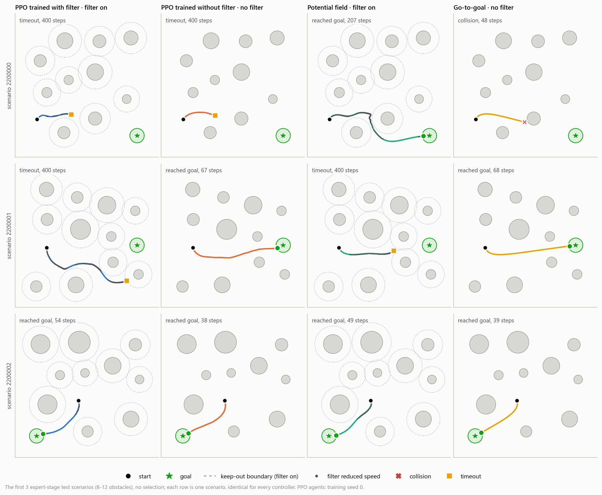
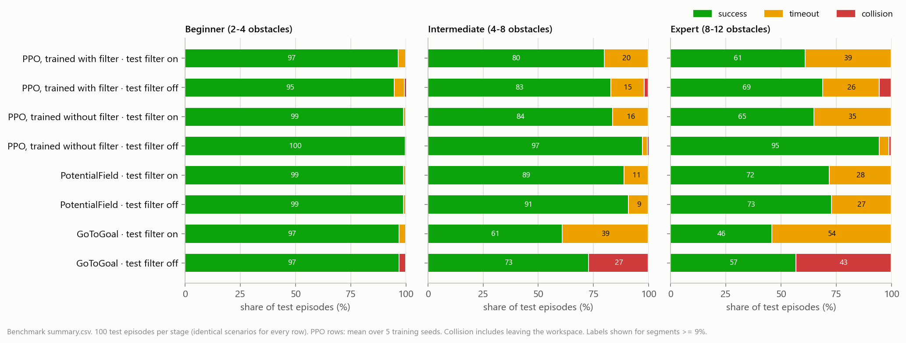
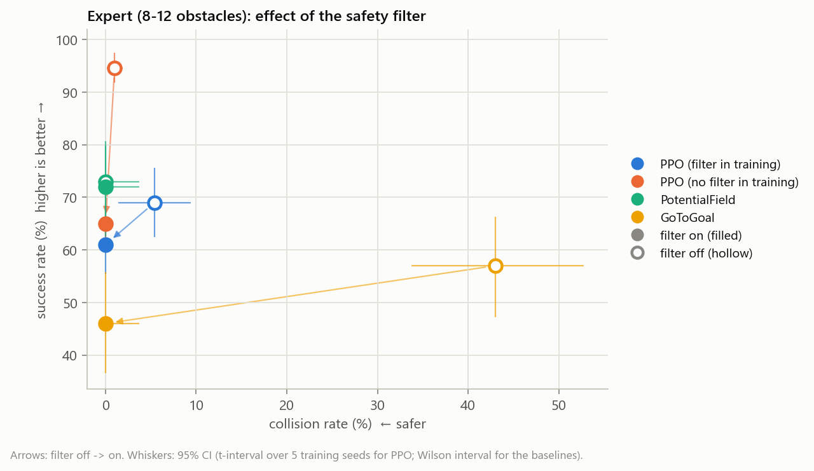
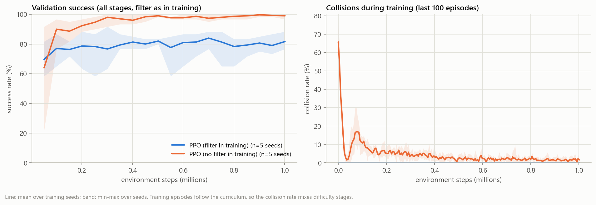
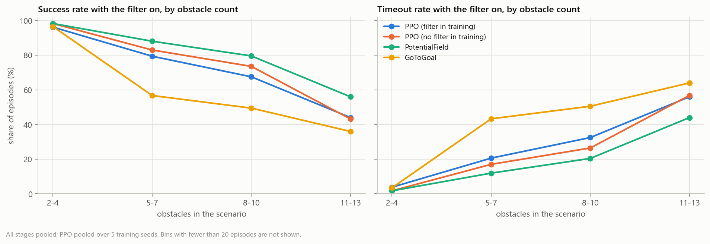
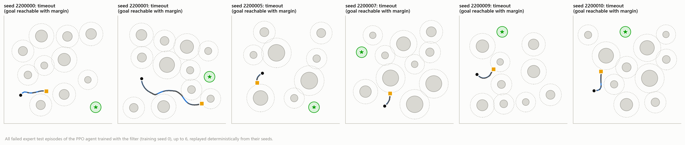
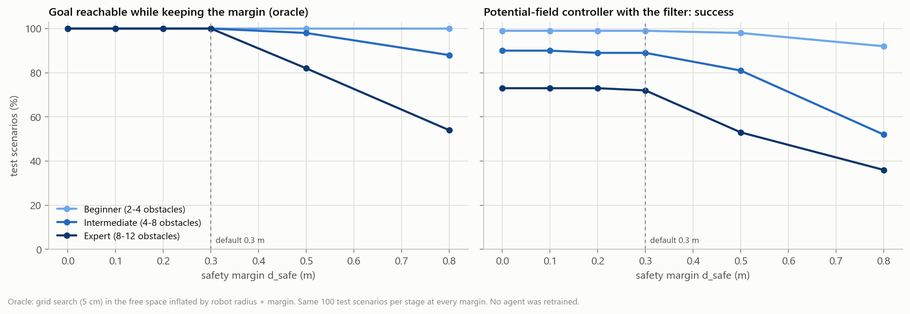
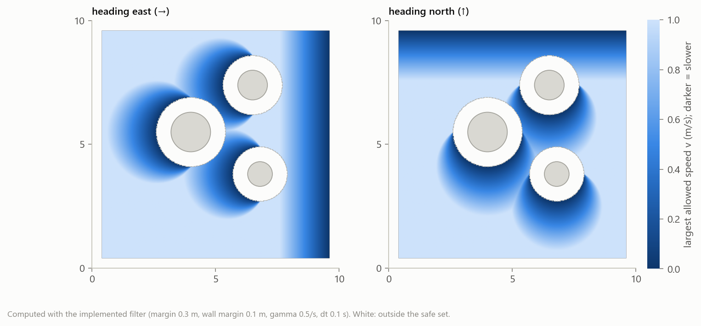

# SafeNav-RL

**Reinforcement learning for 2D robot navigation with a control-barrier-function safety filter — a simulator with a range sensor, PPO agents, two classical baselines and a multi-seed benchmark that measures what the filter buys and what it costs.**

[](https://www.python.org/)
[](https://pytorch.org/)
[](https://gymnasium.farama.org/)
[](LICENSE)

<p align="center">
  
</p>
<p align="center"><em>The first three expert test scenarios (no selection) for four controllers. Dashed circles: the keep-out boundary the filter enforces; dark dots: steps where the filter reduced the speed.</em></p>

## Key results (simulation)

Five training seeds per PPO variant, 1M steps each; 100 seeded test scenarios per difficulty stage, identical for every controller.

- **The filter removed every collision.** Across all 3,600 test episodes with the filter on (every controller and stage) there was no collision, and the closest approach was exactly the 0.30 m margin. Without it, the go-to-goal controller collided in 43 % of expert episodes and the PPO agent trained without the filter in 1.0 %.
- **The price is deadlock.** With the filter, robots can stop at a keep-out boundary and time out. On the expert stage the PPO agent trained without the filter falls from 94.6 % success to 65.0 % when the filter is added at test time.
- **Training with the filter in the loop did not help** under the standard deterministic evaluation (61.0 % expert success vs. 65.0 % for training without it), and its validation success plateaued early (about 80 %). Sampling actions from the policy instead of taking its mean breaks many deadlocks and raises it to 76.4 %, above the potential-field controller with the filter (72 %).

| Expert stage (8–12 obstacles) | success | collision | timeout |
|---|:---:|:---:|:---:|
| PPO trained without filter · no filter | 94.6 % [91.7, 97.5] | 1.0 % | 4.4 % |
| PPO trained without filter · filter at test time | 65.0 % [61.5, 68.5] | **0 %** | 35.0 % |
| PPO trained with filter · filter on | 61.0 % [55.4, 66.6] | **0 %** | 39.0 % |
| PPO trained with filter · filter on, sampled actions | 76.4 % [68.2, 84.6] | **0 %** | 23.6 % |
| Potential field · filter on | 72.0 % [62.5, 79.9] | **0 %** | 28.0 % |
| Potential field · no filter | 73.0 % [63.6, 80.7] | 0 % | 27.0 % |
| Go-to-goal · filter on | 46.0 % [36.6, 55.7] | **0 %** | 54.0 % |
| Go-to-goal · no filter | 57.0 % [47.2, 66.3] | 43.0 % | 0 % |

*Brackets: 95 % intervals (t-interval over 5 training seeds for PPO, Wilson interval over 100 episodes for the deterministic baselines). Source: [`results/benchmark/summary.csv`](results/benchmark/summary.csv), [`results/stochastic_eval/summary.json`](results/stochastic_eval/summary.json).*

These are results in a 2D simulator with static circular obstacles and exact kinematics. Nothing here was tested on a robot.

## What the code does

| Part | Content |
|---|---|
| **Environment** | Gymnasium env: unicycle robot in a 10 × 10 m workspace with 2–12 circular obstacles, a simulated 16-beam 360° range sensor, shaped reward, three-stage curriculum, seeded scenarios (`safenav/env/`) |
| **Safety filter** | discrete-time control barrier function on the speed, closed-form solution of the safety QP, obstacle and wall constraints; forward invariance proven for the simulator's dynamics ([`docs/SAFETY.md`](docs/SAFETY.md)) |
| **Agents** | PPO actor-critic; go-to-goal and potential-field baselines that read the same observation (`safenav/agents/`) |
| **Training** | PPO with GAE, truncation bootstrapping, linear LR decay, validation-based checkpoint selection, CSV logs, exact resumption after interruption, parallel multi-seed runs (`safenav/training/`) |
| **Evaluation** | seeded test episodes; success, collision (obstacle vs. leaving the workspace), timeout, SPL, path efficiency, clearance, filter interventions, smoothness; Wilson and t intervals; geometric feasibility oracle; benchmark and safety-margin sweep writing CSV/JSON (`safenav/evaluation/`) |
| **Figures** | every README figure is generated from the stored outputs by `python -m safenav plot` (`safenav/viz/`) |


## Results in detail

<p align="center"></p>

<p align="center">
  
</p>
<p align="center"><em>Expert stage: each arrow goes from filter off (hollow) to filter on (filled). The filter moves every controller to zero collisions; how much success it costs depends on the controller.</em></p>

**Training.** Agents trained without the filter reach about 99 % validation success; agents trained with it level off near 80 % after roughly 0.2M steps. Three of the five filtered seeds selected their best checkpoint (highest validation success) within the first 0.31M steps.

<p align="center"></p>

**Where the policies struggle.** Timeouts grow with the number of obstacles for every controller with the filter on. Replaying the failed expert episodes of the filter-trained agent shows the mechanism: in most of them the robot reaches a keep-out boundary early and stops there for the rest of the episode, although a path that keeps the margin exists (oracle). The deterministic policy keeps steering into the boundary; sampled actions often escape (table above).

<p align="center">
  
  
</p>

**Safety margin.** With an exactly enforced 0.8 m margin (the value in version 0.1) only 54 % of the expert scenarios have any path that keeps the margin, so the default is 0.3 m ([`docs/SAFETY.md`](docs/SAFETY.md)).

<p align="center"></p>

## The safety filter in one paragraph

For every obstacle and wall, a barrier `h` measures the clearance left beyond the margin. The filter keeps the policy's turn rate and lowers its speed until, for every barrier the robot is approaching, `v · a ≤ γ · h` (`a`: closing rate per unit speed, `γ = 0.5 s⁻¹`). For the simulator's Euler unicycle this guarantees `h_{t+1} ≥ (1 − γ·dt) · h_t`, so a robot that starts in the safe set never leaves it, **under the stated assumptions**: exact dynamics, exactly known static circular obstacles, true state, and a safe start. It does not guarantee reaching the goal. Proof, assumptions and tests: [`docs/SAFETY.md`](docs/SAFETY.md).

<p align="center"></p>

## Environment

| | |
|---|---|
| Observation (23 values) | normalised position, sin/cos heading, distance and bearing to the goal, proximity risk, 16 range readings (0–3 m, Gaussian noise) |
| Action | `v ∈ [0, 1] m/s`, `ω ∈ [-1, 1] rad/s` (clipped) |
| Dynamics | forward-Euler unicycle, `dt = 0.1 s` |
| Reward | −0.01 per step + (distance gained) − 0.5 × risk + 10 on reaching the goal − 5 on collision or leaving the workspace |
| Episode end | goal within 0.5 m; collision; leaving the workspace; step limit (200 / 300 / 400 by stage) |
| Curriculum | beginner (2–4 obstacles, goal 3–5 m) → intermediate (4–8, 5–8 m) → expert (8–15 requested, at most 12 placed, 5–12 m); advance at 70 % success over 100 episodes |

## Installation

```bash
git clone https://github.com/pouyapd/SafeNav-RL.git
cd SafeNav-RL
pip install -e ".[dev]"              # Python 3.10+; CPU PyTorch is enough
```

## Quick start

```bash
# evaluate a committed agent (trained with the filter, seed 0) on 20 test scenarios per stage
python -m safenav evaluate --checkpoint results/checkpoints/filtered/seed_0.pt --episodes 20

# a baseline, with and without the filter
python -m safenav evaluate --baseline potential_field --episodes 20 --safety-filter off

# plot or animate one seeded episode
python scripts/visualize_trajectory.py --checkpoint results/checkpoints/unfiltered/seed_0.pt --stage expert --seed 2200001 --safety-filter off
python scripts/visualize_trajectory.py --baseline potential_field --animate --save episode.gif

# train one agent (1M steps take about 20 minutes on one free laptop CPU core; this example uses 200k)
python -m safenav train --run-dir runs/demo --seed 0 --set ppo.total_timesteps=200000
python -m safenav train --run-dir runs/demo --resume          # continue after an interruption
```

## Reproduce the benchmark

```bash
python -m safenav train-many --out runs/benchmark --seeds 0 1 2 3 4 --jobs 10          # 10 runs x 1M steps
python -m safenav benchmark --runs runs/benchmark --out results/benchmark --jobs 8
python -m safenav safety-sweep --out results/safety_sweep
python scripts/stochastic_eval.py --runs runs/benchmark --out results/stochastic_eval
python -m safenav plot --benchmark results/benchmark --runs results/training_logs --sweep results/safety_sweep
```

On a 10-core laptop CPU the ten training runs ran in parallel and took 2.6–3.7 hours each; the benchmark took about 3 minutes. Training is deterministic for a given seed on CPU, and resumption is exact; both are covered by tests. The checkpoints used for the tables are in [`results/checkpoints/`](results/checkpoints/) (selected by validation success on seeds disjoint from the test seeds), with their training logs in [`results/training_logs/`](results/training_logs/).

## Tests

```bash
pytest            # 86 tests, about a minute
```

The tests cover the unicycle update, termination and reward terms, the range sensor against analytic geometry, seeding, the filter's closed-form limits and its invariance under an adversarial policy, GAE against hand-computed values, the consistency of stored actions and log-probabilities, bit-for-bit reproducibility and exact resumption of training, metric and interval calculations, the feasibility oracle, config validation, the baselines, the ROS 2 scan conversion, and an end-to-end train → benchmark → plot run. A GitHub Actions workflow (`.github/workflows/tests.yml`) is set up to run them on Python 3.10 and 3.12.

## Project structure

```text
SafeNav-RL/
├── safenav/
│   ├── env/          # navigation_env.py, obstacle_map.py (geometry, ray casting), curriculum.py
│   ├── safety/       # cbf_filter.py: CBFSafetyFilter, SafetyFilterWrapper, SafetyLayer (v0.1 interface)
│   ├── agents/       # actor_critic.py, policy.py (PPOPolicy, checkpoints), baselines.py
│   ├── training/     # ppo_trainer.py, rollout_buffer.py, callbacks.py (logs, checkpoints)
│   ├── evaluation/   # metrics.py, runner.py, feasibility.py, benchmark.py, sweep.py
│   ├── viz/          # figures.py, plots.py, style.py
│   ├── config.py     # loading, overrides, validation
│   └── cli.py        # python -m safenav ...
├── configs/default_config.yaml
├── results/          # benchmark, safety sweep, sampled-action evaluation, training logs, checkpoints
├── docs/             # SAFETY.md, figures/
├── scripts/          # train/evaluate/visualize wrappers, stochastic_eval.py
├── ros2_integration/ # untested ROS 2 node scaffold + tested scan helpers
└── tests/
```

## Changes in version 0.2

- **Fixed (PPO):** the rollout stored the safety-projected action together with the log-probability of the unprojected sample, so the PPO probability ratio was wrong from the first epoch; the filter now runs inside the environment and the buffer keeps the policy's own sample.
- **Fixed (GAE):** advantages used `dones[t+1]` for transition `t`, although the buffer stores each transition's own done flag, so bootstrapping leaked across episode boundaries. Time-limit truncations now bootstrap from the value of the final observation.
- **Replaced (safety layer):** version 0.1 only reacted after the robot was inside the margin and had no wall constraint; see [`docs/SAFETY.md`](docs/SAFETY.md) for the measured behaviour and the new filter.
- **Fixed:** `step()` returned NumPy booleans; evaluation episodes were not seeded; the observation size was hard-coded.
- **Added:** range sensor, baselines, evaluation metrics and intervals, feasibility oracle, benchmark, safety-margin sweep, CLI, config validation, exact resumption, 86 tests, CI workflow and this benchmark. The demo images of version 0.1 (`assets/`) came from a checkpoint that is not available and were produced by the old code.

## Limitations

- Simulation only: 2D, static circular obstacles, exact kinematics, perfect obstacle knowledge for the filter. No sim-to-real study.
- The filter guarantee depends on the assumptions in [`docs/SAFETY.md`](docs/SAFETY.md); it does not extend to a physical robot or to the ROS 2 scaffold.
- Five training seeds per variant and 100 test scenarios per stage; PPO hyperparameters were not tuned for the filtered setting.
- The potential-field baseline was tuned briefly by hand; it is a reference point, not a state-of-the-art planner.
- The ROS 2 node (`ros2_integration/`) has never been run with ROS 2, on a robot or in Gazebo.

## Related projects

- [SafeTraj-Experiments](https://github.com/pouyapd/SafeTraj-Experiments) — MSc thesis: failure analysis of pretrained neural trajectory predictors for a smart wheelchair (EU project REXASI-PRO).
- [SafeTraj-Prototype](https://github.com/pouyapd/SafeTraj-Prototype) — toolkit for trajectory checks, novelty scores, risk maps and failure rules.
- [trajectory-failure-analysis](https://github.com/pouyapd/trajectory-failure-analysis) — interpretable failure analysis of pedestrian trajectory prediction (ETH dataset), preprint.

## Citation

```bibtex
@software{safenav_rl,
  author  = {Bathaei Pourmand, Pouya},
  title   = {SafeNav-RL: Reinforcement Learning with a Control-Barrier-Function Safety Filter for 2D Robot Navigation},
  year    = {2026},
  version = {0.2.0},
  url     = {https://github.com/pouyapd/SafeNav-RL}
}
```

## License

MIT — see [LICENSE](LICENSE).
